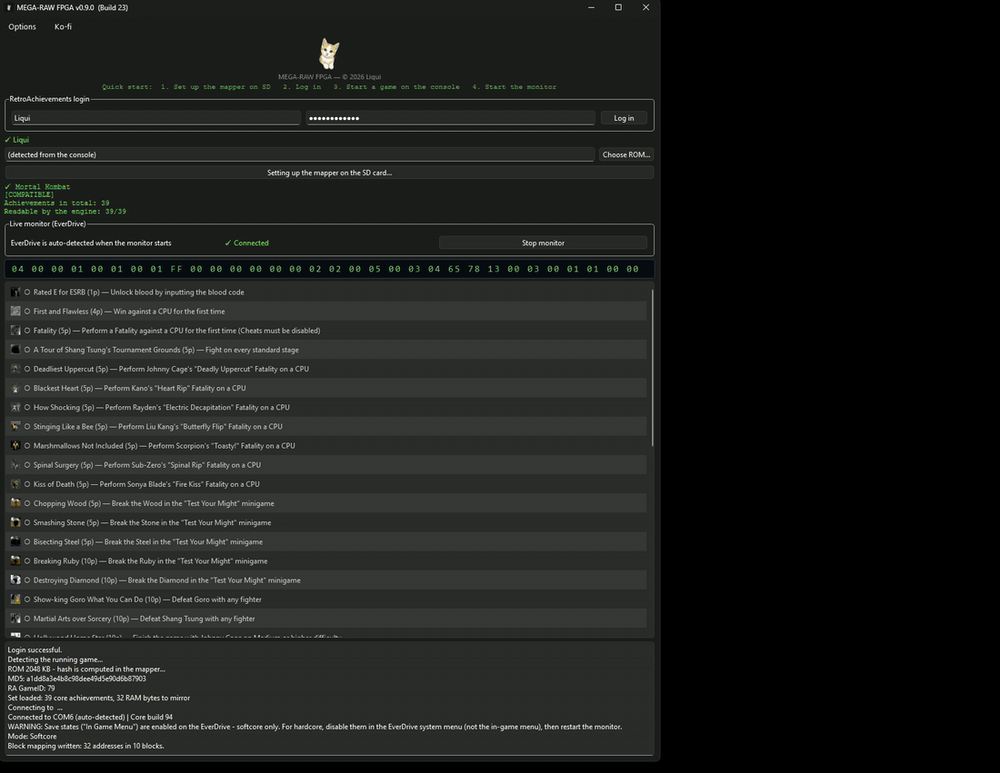
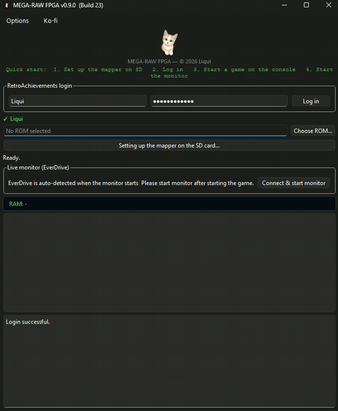

# MEGA-RAW

**RetroAchievements on real Mega Drive hardware — no emulator, no ROM patch.**

MEGA-RAW connects a physical Mega Drive, a Mega EverDrive CORE and
RetroAchievements.
A custom FPGA core on the EverDrive identifies the cartridge by itself and
brings its own in-game save state menu along.

**Project page: https://liquid-wq.github.io/mega-raw/**

*An achievement unlocking on real hardware.*

*Log in, and the cartridge in the console identifies itself.*

*Deutsche Fassung weiter unten.*

---

## What's new in 2.0.0

* **One program file.** No installation, no Qt libraries. The FPGA cores for
  CORE and PRO are built in and are put onto the SD card from inside the
  program.
* **First-run setup.** On the first start MEGA-RAW asks for your language and
  offers to set up the SD card.
* **Clear status messages.** If something is missing, MEGA-RAW tells you
  whether it is the USB cable, the console or the game, and what to do next.
* **Stops by itself.** If the console is switched off while monitoring, the
  monitor stops and the achievement list is cleared.
* **Seven languages:** English, German, Spanish, Portuguese (Brazil), French,
  Italian, Polish.
* **Copy log** button for bug reports.

## Two builds

| | FPGA *(recommended)* | Legacy *(patched)* |
|---|---|---|
| ROM stays untouched | yes | no, an IPS patch is applied |
| Game detection | automatic, from the cartridge | manual file selection |
| Hook database needed | no | yes |
| 2 MB size limit | no | yes |
| In-game save state menu | yes, its own | the EverDrive's own |
| Hardcore mode | planned, see below | no |
| Games prepared | any Mega Drive cartridge | 602 patched titles |

The FPGA build replaces the cartridge mapper with a custom core. Nothing is
patched, nothing is injected, and no per-game hook database has to be maintained.

The legacy build patches a small routine into the ROM that reports values the PC
reads over USB. It still works and stays available, but new work goes into the
FPGA build.

## How it works

A custom FPGA core on the Mega EverDrive takes the place of the standard
mapper. While you play, it hands the values the achievements need to your PC
over USB, and MEGA-RAW checks the RetroAchievements conditions there.

- **Nothing is patched.** The game runs unmodified, and nothing is written
  back into it.
- **Automatic detection.** The cartridge is recognised by itself, no ROM
  folder and no manual selection needed.
- **Save state menu** — replacing the cartridge mapper normally costs you the
  EverDrive's in-game menu. MEGA-RAW brings its own along instead, built from
  scratch: it saves the complete state
  of the console and puts it back exactly as it was. Start + Down opens it over
  the running game: CONTINUE, SAVE, LOAD, EXIT. Four slots per game, stored as
  files on the SD card, so they survive switching the console off.

### Known limits

A few games cannot open the menu, and sound is not part of a save state.

Some games use the Start button themselves. If **Continue** does not react in the
menu, confirm with **C** instead.

## Requirements

- Mega EverDrive CORE (Krikzz) — this is what MEGA-RAW is developed and tested on.
- Mega EverDrive PRO — experimental support since 1.3.0. Achievements work there
  according to tester feedback, the in-game menu does not work on the PRO yet.
  Feedback is welcome as a [GitHub Issue](https://github.com/liquid-wq/mega-raw/issues).
- Other models are untested.
- Original Mega Drive / Genesis hardware
- USB connection between EverDrive and PC
- Windows
- A free RetroAchievements account

## Setup

1. Download the latest release, unpack it and start `mega-raw.exe`.
2. The first-run setup asks for your language and offers **Set up mapper on SD
   card**. Point it at your SD card. The custom cores for both devices (CORE
   and PRO) are copied to every location the console loads from; each device
   picks its own file. This can also be done later from the main window.
3. Log in with your RetroAchievements account. With **Stay logged in** the
   program signs you in by itself next time; your password is not stored.
4. Put the card back into the console, connect the EverDrive by USB and start
   a game.
5. Press **Connect & start monitor**. The game is detected automatically.

## Hardcore mode

Hardcore is planned, but not active yet. RetroAchievements only counts Hardcore
unlocks from clients it has approved, and a client has to be publicly available
for at least six months before it can be considered. MEGA-RAW is still too new
for that, and it also has to pass a set of checks by RetroAchievements. Until
then, every unlock is recorded as Softcore.

The groundwork is already in place: MEGA-RAW checks your setup before and during
a session. If the EverDrive's in-game menu or cheats are enabled, it says so and
stays in Softcore.

## License

MEGA-RAW is free to use. The source is public to read and audit, but it is not
open source — see [LICENSE](LICENSE).

Third-party components are listed in
[THIRD-PARTY-NOTICES.txt](THIRD-PARTY-NOTICES.txt).

## Repository layout

| Folder | Contents |
|---|---|
| `src/`, `assets/` | MEGA-RAW 2.0.0 (current) |
| `legacy/qt/` | the FPGA build, Qt version 1.x |
| `legacy/cpp/` | the patched build, C++ port |
| `legacy/python/` | the patched build, original Python version |

## Related

There are counterparts for the NES, the Super Nintendo and the Saturn:
[RAW-NES](https://github.com/liquid-wq/raw-nes),
[RAW-SNES](https://github.com/liquid-wq/raw-snes) and
[RAW-TURN](https://github.com/liquid-wq/raw-turn).

Built by [Liqui](https://github.com/liquid-wq).

---

# MEGA-RAW (deutsch)

**RetroAchievements auf echter Mega-Drive-Hardware — kein Emulator, kein
ROM-Patch.**

MEGA-RAW verbindet ein echtes Mega Drive, ein Mega EverDrive CORE und
RetroAchievements. Ein eigener FPGA-Kern auf dem EverDrive erkennt die Kassette selbst und bringt
ein eigenes Ingame-Menü für Speicherstände mit.

**Projektseite: https://liquid-wq.github.io/mega-raw/**

## Neu in 2.0.0

* **Eine einzige Programmdatei.** Keine Installation, keine Qt-Bibliotheken.
  Die FPGA-Kerne für CORE und PRO sind eingebaut und werden aus dem Programm
  heraus auf die SD-Karte gebracht.
* **Ersteinrichtung.** Beim ersten Start fragt MEGA-RAW nach der Sprache und
  bietet an, die SD-Karte einzurichten.
* **Klare Statusmeldungen.** Fehlt etwas, sagt MEGA-RAW, ob es am USB-Kabel,
  an der Konsole oder am Spiel liegt und was zu tun ist.
* **Stoppt von selbst.** Wird die Konsole während der Überwachung
  ausgeschaltet, stoppt der Monitor und die Achievement-Liste wird geleert.
* **Sieben Sprachen:** Englisch, Deutsch, Spanisch, Portugiesisch (Brasilien),
  Französisch, Italienisch, Polnisch.
* Knopf **Log kopieren** für Fehlermeldungen.

## Zwei Fassungen

| | FPGA *(empfohlen)* | Klassisch *(gepatcht)* |
|---|---|---|
| ROM bleibt unverändert | ja | nein, es wird ein IPS-Patch angewendet |
| Spielerkennung | automatisch, aus der Kassette | Datei von Hand wählen |
| Hook-Datenbank nötig | nein | ja |
| 2-MB-Grenze | nein | ja |
| Ingame-Menü für Speicherstände | ja, ein eigenes | das des EverDrive |
| Hardcore-Modus | geplant, siehe unten | nein |
| Vorbereitete Spiele | jede Mega-Drive-Kassette | 602 gepatchte Titel |

Die FPGA-Fassung ersetzt den Kassetten-Mapper durch einen eigenen Kern. Es wird
nichts gepatcht, nichts eingeschleust, und es muss keine Hook-Datenbank gepflegt
werden.

Die klassische Fassung patcht eine kleine Routine ins ROM, die Werte meldet, die
der PC über USB liest. Sie funktioniert weiterhin und bleibt verfügbar, neue
Arbeit fließt aber in die FPGA-Fassung.

## Wie es funktioniert

Ein eigener FPGA-Kern auf dem Mega EverDrive ersetzt den Standard-Mapper.
Während du spielst, gibt er die Werte, die die Achievements brauchen, per USB
an den PC weiter, und MEGA-RAW prüft dort die Bedingungen von
RetroAchievements.

- **Nichts wird gepatcht.** Das Spiel läuft unverändert, und es wird nichts
  hineingeschrieben.
- **Automatische Erkennung.** Die Kassette wird von selbst erkannt, kein
  ROM-Ordner und keine Auswahl von Hand nötig.
- **Speicherstand-Menü** — wer den Kassetten-Mapper ersetzt, verliert damit
  normalerweise das Ingame-Menü des EverDrive. MEGA-RAW bringt deshalb ein
  eigenes mit, komplett
  selbst gebaut: Es sichert den vollständigen Zustand der Konsole und stellt ihn
  exakt wieder her. Start + Runter öffnet es über dem laufenden Spiel: CONTINUE,
  SAVE, LOAD, EXIT. Vier Slots je Spiel, als Dateien auf der SD-Karte, sie
  überleben also das Ausschalten.

### Bekannte Einschränkungen

Bei einigen wenigen Spielen lässt sich das Menü nicht öffnen, und der Ton ist
nicht Teil eines Speicherstands.

Manche Spiele belegen die Start-Taste selbst. Reagiert **CONTINUE** im Menü nicht,
stattdessen mit **C** bestätigen.

## Voraussetzungen

- Mega EverDrive CORE (Krikzz) — darauf wird entwickelt und getestet.
- Mega EverDrive PRO — seit 1.3.0 testweise unterstützt. Achievements funktionieren
  dort laut Rückmeldung eines Testers, das Ingame-Menü läuft auf dem PRO noch nicht.
  Rückmeldungen gern als [GitHub Issue](https://github.com/liquid-wq/mega-raw/issues).
- Andere Modelle sind ungetestet.
- Original Mega Drive / Genesis
- USB-Verbindung zwischen EverDrive und PC
- Windows
- Ein kostenloses RetroAchievements-Konto

## Einrichtung

1. Die aktuelle Fassung herunterladen, entpacken und `mega-raw.exe` starten.
2. Die Ersteinrichtung fragt nach der Sprache und bietet **Mapper auf SD-Karte
   einrichten** an. Dort die SD-Karte angeben. Die eigenen Kerne für beide
   Geräte (CORE und PRO) werden an alle Stellen kopiert, von denen die Konsole
   lädt; jedes Gerät nimmt seine eigene Datei. Das geht auch später im
   Hauptfenster.
3. Mit dem RetroAchievements-Konto anmelden. Mit **Eingeloggt bleiben** meldet
   sich das Programm beim nächsten Start selbst an; das Passwort wird nicht
   gespeichert.
4. Karte zurück in die Konsole stecken, das EverDrive per USB verbinden und ein
   Spiel starten.
5. **Verbinden & Monitor starten** drücken. Das Spiel wird automatisch erkannt.

## Hardcore-Modus

Hardcore ist geplant, aber noch nicht aktiv. RetroAchievements wertet
Hardcore-Freischaltungen nur von Programmen, die es freigegeben hat, und ein
Programm muss dafür mindestens sechs Monate öffentlich verfügbar sein. Dafür ist
MEGA-RAW noch zu neu, außerdem muss es eine Reihe von Prüfungen durch
RetroAchievements bestehen. Bis dahin wird jede Freischaltung als Softcore gebucht.

Die Grundlage ist schon vorhanden: MEGA-RAW prüft die Einrichtung vor und während
einer Sitzung. Sind das Ingame-Menü oder Cheats des EverDrive eingeschaltet, weist
MEGA-RAW darauf hin und bleibt bei Softcore.

## Lizenz

MEGA-RAW ist kostenlos nutzbar. Der Quelltext ist öffentlich einsehbar und
prüfbar, aber nicht Open Source — siehe [LICENSE](LICENSE).

Fremde Bestandteile sind in
[THIRD-PARTY-NOTICES.txt](THIRD-PARTY-NOTICES.txt) aufgeführt.

## Verwandte Projekte

Gegenstücke gibt es für NES, Super Nintendo und Saturn:
[RAW-NES](https://github.com/liquid-wq/raw-nes),
[RAW-SNES](https://github.com/liquid-wq/raw-snes) und
[RAW-TURN](https://github.com/liquid-wq/raw-turn).

Gebaut von [Liqui](https://github.com/liquid-wq).
