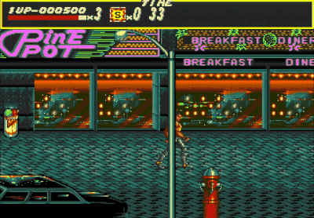
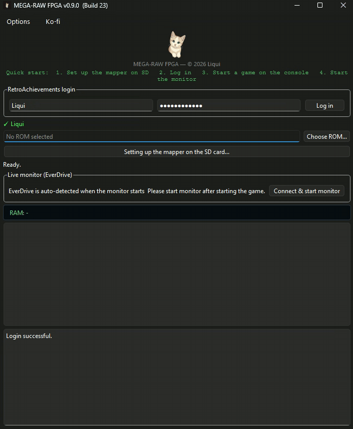

# MEGA-RAW

**RetroAchievements on the original Mega Drive — no emulator, no ROM patch.**

One of four tools for RetroAchievements on real hardware:
NES · Super Nintendo · Mega Drive · Saturn → [all projects](https://liquid-wq.github.io/)

MEGA-RAW brings RetroAchievements to the original Mega Drive console. The game
runs on the real console, the Mega EverDrive simply takes the place of the
cartridge. A custom FPGA core on the EverDrive identifies the game by itself,
shows your achievements right on the TV and brings its own in-game save state
menu along.

**Project page: https://liquid-wq.github.io/mega-raw/**

*An achievement popping up on the console's own picture.*

*Log in, start a game, and it identifies itself.*

*Deutsche Fassung weiter unten.*

---

## What's new in 2.1.0

**The highlight: your achievements now appear right in the game.** No more looking at the PC
or the tool while you play.

* **Achievement popup in the game.** When you unlock an achievement, a banner
  with its title flies in on the console's own picture. The game holds for about
  three seconds and then carries on by itself. The popup waits for a calm
  moment, so it does not interrupt a jump. If you'd rather not have it, you can
  turn it off under Options → "Achievement popup in the game".
* **Starts by itself.** Connect the EverDrive, start a game, and MEGA-RAW
  detects it and starts monitoring. No button to press.
* **SD card setup over USB.** The SD card stays in the EverDrive. MEGA-RAW
  finds the right folders by itself, shows them for confirmation and only
  touches folders where the core is missing or outdated.

## How it works

A custom FPGA core on the Mega EverDrive takes the place of the standard
mapper. While you play, it hands the values the achievements need to your PC
over USB, and MEGA-RAW checks the RetroAchievements conditions there.

- **Nothing is patched.** The game runs unmodified, and nothing is written
  back into it.
- **Automatic detection.** The game is recognised by itself, no ROM folder and
  no manual selection needed.
- **Achievement popup** on the TV, in the same look in every game.
- **Save state menu** — replacing the cartridge mapper normally costs you the
  EverDrive's in-game menu. MEGA-RAW brings its own along instead, built from
  scratch: it saves the complete state of the console and puts it back exactly
  as it was. Start + Down opens it over the running game: CONTINUE, SAVE, LOAD,
  EXIT. Four slots per game, stored as files on the SD card, so they survive
  switching the console off.

### Known limits

A few games cannot open the menu, and sound is not part of a save state.

Some games use the Start button themselves. If **Continue** does not react in
the menu, confirm with **C** instead.

## Requirements

- Mega EverDrive CORE (Krikzz) — this is what MEGA-RAW is developed and tested on.
- Mega EverDrive PRO — experimental. Achievements work there according to
  tester feedback; the in-game menu and the popup are not available on the PRO
  yet. Feedback is welcome as a
  [GitHub Issue](https://github.com/liquid-wq/mega-raw/issues).
- Other models are untested.
- Original Mega Drive / Genesis hardware
- USB connection between EverDrive and PC
- Windows
- A free RetroAchievements account

## Setup

1. Download the latest release, unpack it and start `mega-raw.exe`.
2. The first-run setup asks for your language and offers **Set up mapper on SD
   card**. Switch the console on, leave it in the EverDrive menu and connect
   the EverDrive by USB. MEGA-RAW then sets up the SD card by itself. Without a
   USB connection it asks for the SD card in a card reader instead. This can
   also be done later from the main window.
3. Log in with your RetroAchievements account. With **Stay logged in** the
   program signs you in by itself next time; your password is not stored.
4. Start a game from the EverDrive menu. MEGA-RAW detects it and starts
   monitoring.

**Updating from 2.0.0:** start the new `mega-raw.exe` and run **Set up mapper
on SD card** once. The popup needs the new core on the SD card.

## Hardcore mode

Hardcore is planned, but not active yet. RetroAchievements only counts Hardcore
unlocks from clients it has approved, and a client has to be publicly available
for at least six months before it can be considered. MEGA-RAW is still too new
for that, and it also has to pass a set of checks by RetroAchievements. Until
then, every unlock is recorded as Softcore.

The groundwork is already in place: MEGA-RAW checks your setup before and during
a session. If the EverDrive's in-game menu or cheats are enabled, it says so and
stays in Softcore.

## Older versions

The Qt version (1.x) and the first version from July 2026, which worked with
patched ROMs, are kept in the `legacy` folder and in the older releases. They
are no longer developed.

## License

MEGA-RAW is free to use. The source is public to read and audit, but it is not
open source — see [LICENSE](LICENSE).

Third-party components are listed in
[THIRD-PARTY-NOTICES.txt](THIRD-PARTY-NOTICES.txt).

## Related

There are counterparts for the NES, the Super Nintendo and the Saturn:
[RAW-NES](https://github.com/liquid-wq/raw-nes),
[RAW-SNES](https://github.com/liquid-wq/raw-snes) and
[RAW-TURN](https://github.com/liquid-wq/raw-turn).

Built by [Liqui](https://github.com/liquid-wq).

---

# MEGA-RAW (deutsch)

**RetroAchievements auf dem originalen Mega Drive — kein Emulator, kein
ROM-Patch.**

Eines von vier Werkzeugen für RetroAchievements auf echter Hardware:
NES · Super Nintendo · Mega Drive · Saturn → [alle Projekte](https://liquid-wq.github.io/)

MEGA-RAW bringt RetroAchievements auf die originale Mega-Drive-Konsole. Das
Spiel läuft auf der echten Konsole, das Mega EverDrive nimmt einfach den Platz
der Kassette ein. Ein eigener FPGA-Kern auf dem EverDrive erkennt das Spiel
selbst, zeigt Achievements direkt im Fernsehbild und bringt ein eigenes
Ingame-Menü für Speicherstände mit.

**Projektseite: https://liquid-wq.github.io/mega-raw/**

## Neu in 2.1.0

**Das Highlight: Deine Achievements erscheinen jetzt direkt im Spiel.** Kein Blick mehr auf
den PC oder das Tool nötig, während du spielst.

* **Achievement-Popup im Spiel.** Bei einer Freischaltung fliegt ein Banner
  mit dem Titel ins Bild der Konsole. Das Spiel hält dafür etwa drei Sekunden
  an und läuft dann von selbst weiter. Das Popup wartet auf einen ruhigen
  Moment und unterbricht keinen Sprung. Wer es nicht möchte, kann es unter
  Optionen → „Achievement-Einblendung im Spiel" abschalten.
* **Startet von selbst.** EverDrive anschließen, Spiel starten – MEGA-RAW
  erkennt es und startet die Überwachung. Kein Knopfdruck nötig.
* **SD-Karte über USB einrichten.** Die Karte bleibt im EverDrive. MEGA-RAW
  findet die richtigen Ordner selbst, zeigt sie zur Bestätigung und ändert nur
  Ordner, in denen der Kern fehlt oder veraltet ist.

## Wie es funktioniert

Ein eigener FPGA-Kern auf dem Mega EverDrive ersetzt den Standard-Mapper.
Während du spielst, gibt er die Werte, die die Achievements brauchen, per USB
an den PC weiter, und MEGA-RAW prüft dort die Bedingungen von
RetroAchievements.

- **Nichts wird gepatcht.** Das Spiel läuft unverändert, und es wird nichts
  hineingeschrieben.
- **Automatische Erkennung.** Das Spiel wird von selbst erkannt, kein
  ROM-Ordner und keine Auswahl von Hand nötig.
- **Achievement-Popup** im Fernsehbild, in jedem Spiel gleich.
- **Speicherstand-Menü** — wer den Kassetten-Mapper ersetzt, verliert damit
  normalerweise das Ingame-Menü des EverDrive. MEGA-RAW bringt deshalb ein
  eigenes mit, komplett selbst gebaut: Es sichert den vollständigen Zustand der
  Konsole und stellt ihn exakt wieder her. Start + Runter öffnet es über dem
  laufenden Spiel: CONTINUE, SAVE, LOAD, EXIT. Vier Slots je Spiel, als Dateien
  auf der SD-Karte, sie überleben also das Ausschalten.

### Bekannte Einschränkungen

Bei einigen wenigen Spielen lässt sich das Menü nicht öffnen, und der Ton ist
nicht Teil eines Speicherstands.

Manche Spiele belegen die Start-Taste selbst. Reagiert **CONTINUE** im Menü
nicht, stattdessen mit **C** bestätigen.

## Voraussetzungen

- Mega EverDrive CORE (Krikzz) — darauf wird entwickelt und getestet.
- Mega EverDrive PRO — testweise. Achievements funktionieren dort laut
  Rückmeldung eines Testers; Ingame-Menü und Popup gibt es auf dem PRO noch
  nicht. Rückmeldungen gern als
  [GitHub Issue](https://github.com/liquid-wq/mega-raw/issues).
- Andere Modelle sind ungetestet.
- Original Mega Drive / Genesis
- USB-Verbindung zwischen EverDrive und PC
- Windows
- Ein kostenloses RetroAchievements-Konto

## Einrichtung

1. Die aktuelle Fassung herunterladen, entpacken und `mega-raw.exe` starten.
2. Die Ersteinrichtung fragt nach der Sprache und bietet **Mapper auf SD-Karte
   einrichten** an. Konsole einschalten, im EverDrive-Menü lassen und das
   EverDrive per USB verbinden – MEGA-RAW richtet die Karte dann selbst ein.
   Ohne USB-Verbindung fragt es stattdessen nach der SD-Karte im Kartenleser.
   Das geht auch später im Hauptfenster.
3. Mit dem RetroAchievements-Konto anmelden. Mit **Eingeloggt bleiben** meldet
   sich das Programm beim nächsten Start selbst an; das Passwort wird nicht
   gespeichert.
4. Ein Spiel im EverDrive-Menü starten. MEGA-RAW erkennt es und startet die
   Überwachung.

**Update von 2.0.0:** die neue `mega-raw.exe` starten und einmal **Mapper auf
SD-Karte einrichten** ausführen. Das Popup braucht den neuen Kern auf der Karte.

## Hardcore-Modus

Hardcore ist geplant, aber noch nicht aktiv. RetroAchievements wertet
Hardcore-Freischaltungen nur von Programmen, die es freigegeben hat, und ein
Programm muss dafür mindestens sechs Monate öffentlich verfügbar sein. Dafür ist
MEGA-RAW noch zu neu, außerdem muss es eine Reihe von Prüfungen durch
RetroAchievements bestehen. Bis dahin wird jede Freischaltung als Softcore gebucht.

Die Grundlage ist schon vorhanden: MEGA-RAW prüft die Einrichtung vor und während
einer Sitzung. Sind das Ingame-Menü oder Cheats des EverDrive eingeschaltet, weist
MEGA-RAW darauf hin und bleibt bei Softcore.

## Ältere Fassungen

Die Qt-Fassung (1.x) und die erste Fassung vom Juli 2026, die mit gepatchten
ROMs arbeitete, liegen im Ordner `legacy` und in den älteren Releases. Sie
werden nicht mehr weiterentwickelt.

## Lizenz

MEGA-RAW ist kostenlos nutzbar. Der Quelltext ist öffentlich einsehbar und
prüfbar, aber nicht Open Source — siehe [LICENSE](LICENSE).

Fremde Bestandteile sind in
[THIRD-PARTY-NOTICES.txt](THIRD-PARTY-NOTICES.txt) aufgeführt.

## Verwandte Projekte

Gegenstücke gibt es für NES, Super Nintendo und Saturn:
[RAW-NES](https://github.com/liquid-wq/raw-nes),
[RAW-SNES](https://github.com/liquid-wq/raw-snes) und
[RAW-TURN](https://github.com/liquid-wq/raw-turn).

Gebaut von [Liqui](https://github.com/liquid-wq).
